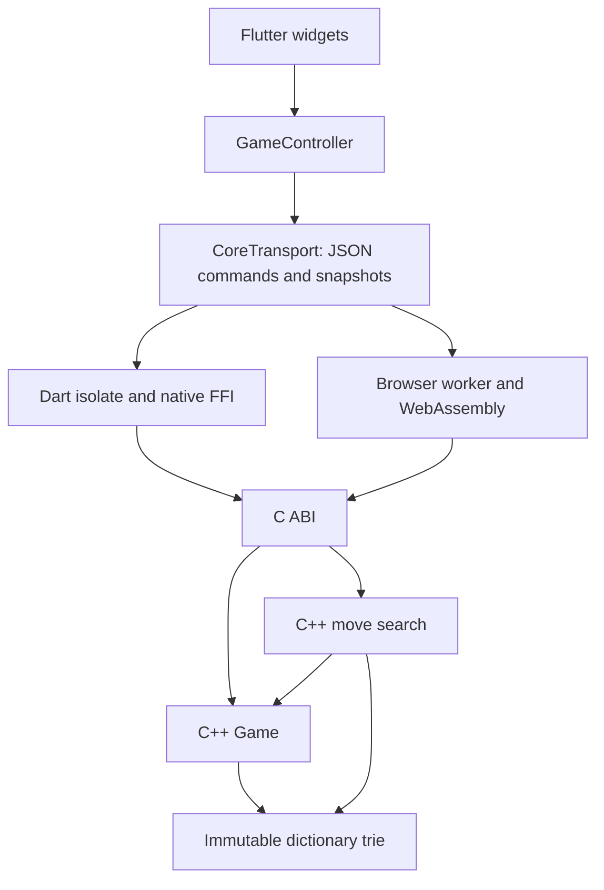

# Architecture and migration

## Existing application

The Android tree is the functional reference. Its `crossword` package contains
the board, racks, tile bags, scoring and word search. `Game` also imports
`MainActivity`, `DbGame` and `DbUser`, so rules, interaction state and persistence
cannot be built or tested independently. `Main` manages application navigation
alongside the game's own state machine. Android views read and drive those
objects directly. Firebase adapters persist user and game documents.

The iOS tree is an incomplete Swift port rather than a deployable second client.
Maintaining those two implementations would continue duplicating rules and
platform coupling. The new application therefore shares one portable engine.

## New ownership boundary

| Responsibility | Implementation |
| --- | --- |
| Board, inventories, rack, turns, scores and game completion | `packages/jot_core/src/engine.cpp` |
| Placement and full-word validation, including crossings and blanks | C++ `Game::evaluate` |
| Dictionary trie and immutable lookup | `packages/jot_core/src/dictionary.cpp` |
| Legal move search and computer decisions | `packages/jot_core/src/ai.cpp` |
| Versioned save documents and validation before restore | C++ engine and `jot_api.cpp` |
| Stable platform interface and action capabilities | `jot_api.h` / `jot_api.cpp` |
| Worker lifecycle and native/web transport | `packages/jot_core/lib/src` and `web/jot_*.js` |
| UI, accessibility, selected tile and blank-letter prompt | Flutter `lib/main.dart` |
| Loading the dictionary, storing opaque saves and scheduling the computer | Flutter `lib/game_controller.dart` |
| Online room authority, credentials, revisions and persistence | Cloudflare Worker and per-room Durable Object in `multiplayer` |
| Private snapshots for an online player | C++ JSON API `view` command |

Mobile and desktop compile the C++17 sources through Flutter's native build
hook. Web compiles the same sources with Emscripten. The browser transport uses
a worker because dictionary loading and computer search should not occupy the
UI thread. Native platforms use a Dart isolate for the same reason.

Android, iOS, Windows, macOS, Linux and web all render the same `GamePage`,
`JotBoard` and rack widgets in `lib/main.dart`. Their runners do not implement
separate game screens. Immediate dragging, visible feedback anchored to the
original grab point, drop highlights and release-to-place use shared Flutter
`Draggable`/`DragTarget` handlers for touch, mouse and stylus input. A drop sends
the same C++ placement command locally or through the multiplayer authority.
`test/platform_drag_test.dart` checks these gestures with each platform's widget
defaults and three viewport sizes; CI also runs the suite in Chrome for web.

The ABI exposes only create, execute and destroy. A worker owns each handle and
executes commands in order. Responses are copied before the next call can
replace the ABI's borrowed buffer. Errors cross the boundary as JSON results or
transport failures; C++ exceptions never cross into Dart or JavaScript.

Public snapshots contain the active rack, board, preview, scores, bag counts and
action availability. Widgets render that state and send intentions back to the
engine. A legal preview cannot commit a turn until the engine also verifies rack
readiness. Save documents include both players' inventories and random state;
restore validates the entire candidate before replacing a live game.

The rewrite preserves the original 16×16 layout, eight-tile rack, player bags,
tile values, bonuses, 100-point bingo and 143,722-word dictionary. Board copies
now have value semantics. Placement validation accepts legal words extended at
both ends of an existing word, and two consecutive passes end a game consistently.

## Local milestone

This version includes a computer opponent, two players sharing one device,
manual vowel/consonant draws, automatic rack fill, staging and recall, scoring,
hints, endgame and automatic local save/resume. Engine and AI tests run without
Flutter. Separate integration tests exercise native FFI and actual WebAssembly,
including saves crossing the native/web boundary.

## Subsequent migration

Online multiplayer applies authenticated commands to a server-owned C++ game
and returns player-specific views. A room is a Cloudflare Durable Object with
SQLite persistence. Its private save contains both racks and remains on the
server. Revisions and idempotent request IDs prevent competing clients and
network retries from replacing or advancing state twice. The Pages API proxy
uses a service binding to reach the Worker. See `MULTIPLAYER.md` for details.

Accounts, rankings, messaging, advertisements and legacy save import remain
future work.

Each target still requires its normal release tooling, app identifiers, signing
and distribution process. The repository includes runners for Android, iOS,
macOS, Windows, Linux and web, plus a build matrix to validate them on their
respective operating systems. A runner or CI configuration alone is not evidence
of a successful release build; see `VERIFICATION.md` for the checks actually run.
